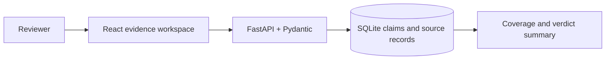

# AI Hallucination Detection and Research Verification System

Independent claim-level evidence tracking for reviewers. The app records sources and reviewer judgments; it does not fetch pages or automatically decide that an unsourced claim is false. Not affiliated with Handshake or any AI lab.

Status: **Implemented, tested, and frontend build verified.** Not deployed. Public GitHub repository: https://github.com/JPPREMKUMAR/ai-hallucination-verification.

## Features

- Split answers into editable individual claims (manual boundary control).
- Record source title, URL, access date, evidence passage, scope, and authority/directness/freshness/relevance ratings.
- Label supported, contradicted, unresolved, or not-checkable.
- Search/filter claims and inspect source coverage and verdict counts.
- Synthetic examples include true facts backed by real primary sources, a contradicted statement, an unresolved time-sensitive claim, an unsupported causal claim, and an opinion.

## Architecture



## Run locally

Use Python 3.12 and Node.js 22 or compatible versions. Copy `.env.example` to `.env` if you need to change `DATABASE_PATH`; the default writes the local SQLite database. The dotenv file is loaded by the API and must remain uncommitted.

```powershell
python -m venv .venv
.\.venv\Scripts\Activate.ps1
pip install -r requirements.txt
uvicorn app.main:app --reload
```

The API seeds the sample claims into an empty local database on startup. Browse `http://127.0.0.1:8000/docs`. The frontend is in `frontend/`; use `npm ci` then `npm run dev` in a second terminal.

## Evidence and decisions

Use primary sources when possible. A source's authority score does not substitute for direct support: quote a passage and record the scope. Use `unresolved` when evidence is absent, conflicting, out of date, or not sufficiently direct. `contradicted` requires evidence that conflicts with the exact claim. `not_checkable` is for opinion or vague language that cannot be operationalized. See `docs/evaluation-methodology.md`.

Sample source links are NASA's [Facts About Earth](https://science.nasa.gov/earth/facts/) and the official [Python data structures tutorial](https://docs.python.org/3/tutorial/datastructures.html), reviewed 2026-10-28. The exact claim passages are stored in the sample dataset so the examples remain inspectable offline.

## Tests and limitations

Run `python -m pytest -q`. The report only describes this dataset. Source scores are reviewer-entered and do not prove that a source is truthful; pages are not fetched or archived by the app. There is no authentication, no automated claim segmentation, and no external search API. See `docs/test-report.md` and `docs/evaluation-methodology.md` for verified results and method.

See [`docs/requirements.md`](docs/requirements.md) for MVP acceptance criteria, [`docs/architecture.md`](docs/architecture.md) for data flow, [`docs/demo.md`](docs/demo.md) for a short walkthrough, [`docs/response-quality-examples.md`](docs/response-quality-examples.md) for labeled cases, and [`docs/deployment.md`](docs/deployment.md) for the current hosting assessment.

## License

MIT. See `LICENSE`.

