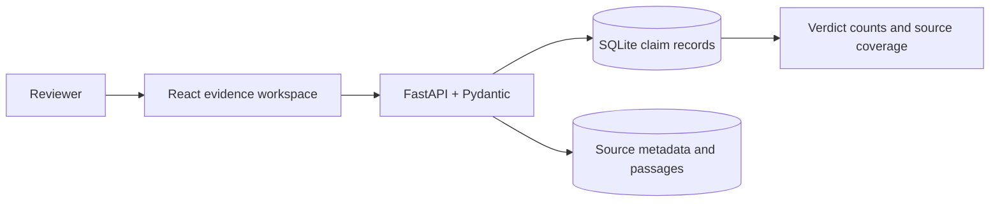

# Architecture

The reviewer controls claim boundaries and verdicts. The API validates claim and source fields, stores evidence notes and labels, and derives simple coverage summaries. It does not fetch source pages, infer verdicts, or mark an unsupported claim false. Source quality dimensions are human-entered metadata.

SQLite and the local sample corpus make this a review-workflow prototype. Authentication, source snapshotting, automated claim extraction, and durable cloud persistence are not implemented.
